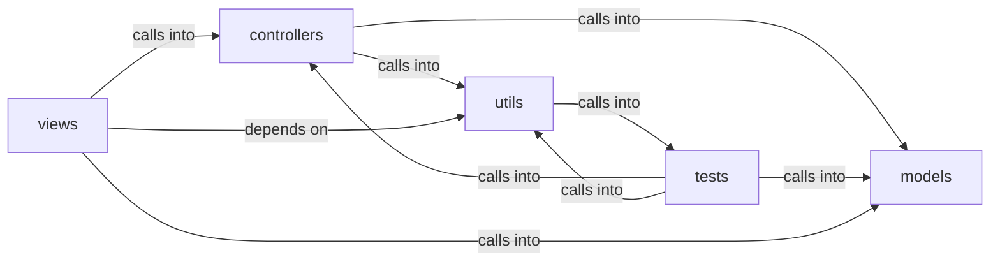

# views: deniable_vault

views: deniable_vault groups 8 files (py) around _get_audit_logger, _correlation_id, audit_event, constant_time_compare, hash_secret. QV-DENIABLE-1 deniable vault: configuration, validation, orchestration.

## controllers (6.1)

controllers groups 1 files (py) around _base64_length, canonical_json, EnvelopeValidationError, _coerce_int, _coerce_kdf. QV-DENIABLE-1 deniable vault: configuration, validation, orchestration.

## models (6.2)

models groups 1 files (py) around DeniableVaultDB, __init__, _init_db, upsert, get. Opaque storage for QV-DENIABLE-1 deniable vault containers.

## tests (6.3)

tests groups 3 files (py) around _hermetic_env, _push_request_context, app, client, _ListLogHandler. Shared pytest fixtures for the QuantumVault test suite.

## utils (6.4)

utils groups 1 files (py) around _get_audit_logger, _correlation_id, audit_event, constant_time_compare, hash_secret. Centralized security primitives for QuantumVault.

## views (6.5)

views groups 2 files (py) around get_deniable_vault_controller, settings, get_vault, put_vault, delete_vault. Account settings page and the deniable vault JSON API (QV-DENIABLE-1).

**Files**:

- controllers/deniable_vault.py
- models/deniable_vault.py
- tests/conftest.py
- tests/test_deniable_vault.py
- tests/test_security.py
- utils/security.py
- views/account.py
- views/sync.py
