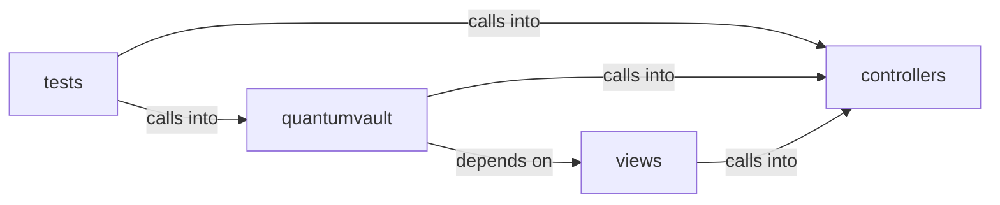

# views: facade

views: facade groups 11 files (py) around _is_production, _build_csp, _build_talisman_kwargs, _configure_secret_key, _configure_session. QV-FACADE-1 cover facade: configuration, gate hashing, tickets, gate control.

## controllers (2.1)

controllers groups 2 files (py) around GateOutcome, GateDecision, _as_bool, _as_int, _as_text. QV-FACADE-1 cover facade: configuration, gate hashing, tickets, gate control.

## quantumvault (2.2)

quantumvault groups 2 files (py) around _is_production, _build_csp, _build_talisman_kwargs, _configure_secret_key, _configure_session. Application factory for QuantumVault.

## tests (2.3)

tests groups 3 files (py) around fast_hasher, _make_user, _authenticated_client, _build, test_facade_enabled_requires_a_deniable_passphrase. Behaviour contract: the decoy site requires a deniable passphrase.

## views (2.4)

views groups 4 files (py) around about, register_facade, render_cover, _facade_cover, facade_gate. about: Render the About page.

**Files**:

- controllers/facade.py
- controllers/sync.py
- quantumvault/app_factory.py
- quantumvault/wsgi.py
- tests/test_account_facade.py
- tests/test_cover.py
- tests/test_facade.py
- views/about.py
- views/facade.py
- views/privacy.py
- views/terms.py
